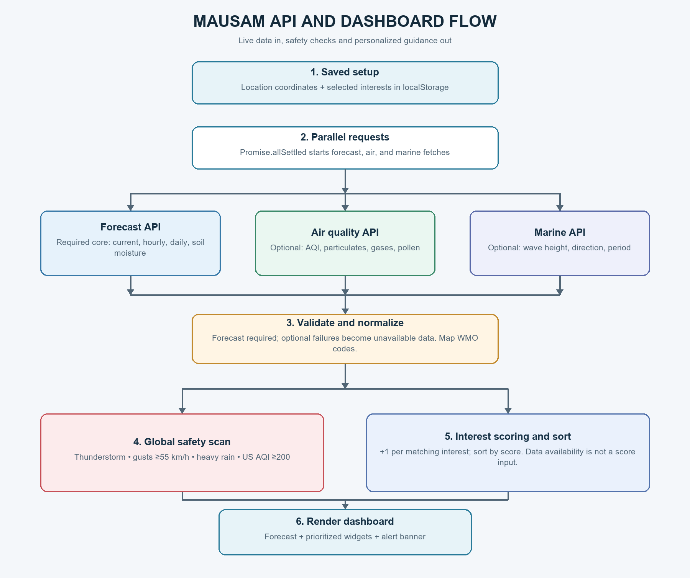

# Mausam Weather Dashboard

Mausam is a personalized weather dashboard built around a decision-first idea: combine forecast, air-quality, and coastal data, then organize weather guidance around the user's interests. The project is a browser-based prototype; recommendations are rule-based and some specialist widgets still use placeholder values or simplified assumptions.

## Project structure

```text
Mausm-web/
├── Documentation/
│   ├── api-flow.png
│   ├── Open-Meteo_API_Documentation.docx
│   └── Mausam_SIH26076_Detailed_Agile_Presentation_HHK_updated.pptx
└── Source code/
    ├── mainUI.html
    ├── script.js
    ├── style.css
    ├── user_intrest.html
    └── user_location.html
```

The dashboard and its Open-Meteo integration currently live in `Source code/mainUI.html`. The project also contains standalone `script.js` and `style.css` files.

## Run the project

Open `Source code/user_intrest.html` in a modern browser to choose interests, then choose a location by search, map, or GPS. The dashboard opens after setup. A local HTTP server is recommended because browser geolocation and other security features may not work from a `file://` URL. An internet connection is required for weather data, map tiles, and location search.

## Open-Meteo data sources

The dashboard starts three requests in parallel with `Promise.allSettled`:

| Service | Endpoint | Data requested by the project |
| --- | --- | --- |
| Forecast | `https://api.open-meteo.com/v1/forecast` | Current conditions; hourly weather, visibility, precipitation probability, and 0–1 cm soil moisture; daily highs/lows, sunrise/sunset, UV, precipitation, and wind. |
| Air quality | `https://air-quality-api.open-meteo.com/v1/air-quality` | US and European AQI, PM2.5, PM10, gases, and selected pollen types. |
| Marine | `https://marine-api.open-meteo.com/v1/marine` | Wave height, direction, period, and wind-wave height. |

All three requests use the saved latitude and longitude. Forecast data is required; air-quality and marine responses are optional, so their failure does not prevent the forecast from rendering. See the Word guide for the exact requested fields, the API flow, and current prototype limitations.

## API flow



The severe-alert scan runs independently of the interest-based widget order. In the current implementation it checks for thunderstorms, high wind gusts, a combined heavy-rain threshold, and US AQI of 200 or more. If multiple rules match, the first matching rule in the code determines the banner.

## Why Mausam stands out

Mausam's design focus is **decision-oriented personalization**: instead of treating every visitor as having the same weather needs, it maps eight interests—health, fitness, beach, travel, family, agriculture, commute, and events—to relevant modules. The same dashboard combines forecast, air-quality/pollen, soil-moisture, and marine data, with simple guidance such as packing suggestions, weather-related commute risk, and an irrigation prompt.

Its differentiator is the combination of:

- **One view across several weather domains:** forecast, air quality and pollen, topsoil moisture, and marine wave conditions.
- **Interest-based ordering:** a widget earns one point for each selected interest that includes it, then widgets are sorted by score.
- **Practical prompts:** thresholds turn some readings into plain-language suggestions, such as packing items or weather-related travel caution.
- **Safety visibility:** severe alerts are rendered above the personalized widget area, regardless of selected interests.
- **Indian daily-use scenarios:** the interest set explicitly includes commuting, families and school travel, agriculture, and coastal recreation.

These are product differentiators, not a claim that competing apps lack similar features. Feature coverage varies by app, region, and subscription tier. For an accurate project presentation, distinguish the working prototype behavior from the planned experience:

| Area | Current prototype behavior |
| --- | --- |
| Relevance score | Counts interest matches and sorts descending. It does not yet use cross-segment synergy or data availability as extra score inputs. |
| Fitness window | Shows a fixed 6:00–7:30 AM suggestion; it is not calculated from hourly heat or safety conditions. |
| School commute | Uses daily rain probability and static risk labels; it does not evaluate specific 8 AM or 3 PM hourly conditions. |
| Traffic | Estimates weather impact from rain, fog, or storm conditions; it does not use live traffic data. |
| Coastal widgets | Uses marine wave fields when available. Tide timing is not requested, and the current water-temperature value is a placeholder. |
| Missing values | Some widgets use fallback numbers when data is absent, so those cases should be tightened before describing the app as strict about never inventing values. |

## Three-layer algorithm model

The algorithm notes below separate the documented target design from the current prototype. The decision-support formulas are useful implementation specifications, but the current code does not yet implement all of them.

### Layer 1: personalization and ranking

**Objective:** Reduce information overload by placing modules that match the selected interests first.

For each selected interest, the current code reads its widget IDs from `WIDGET_MAP` and adds one point to each mapped widget:

```text
score(widget) = count of selected interests that map to the widget
```

It sorts the unique matched widgets by descending score. With `I` selected interests, at most `W` mapped widgets per interest, and `K` unique matched widgets, the expected work is `O(I × W + K log K)`. The code returns all matched widgets; it does not apply a separate top-K cutoff, score availability, or cross-segment synergy.

### Layer 2: decision support and sensor fusion

These are the proposed domain decisions and the notes needed to implement them accurately.

1. **Workout window optimization.** Target score: `SafetyScore(t) = 100 − f(HeatIndex(t)) − f(AQI(t)) − f(UV(t)) + DaylightBonus(t)`. The functions, weights, safe thresholds, and missing-data policy still need definition. Current code displays apparent temperature and a fixed 6:00–7:30 AM suggestion; it does not combine hourly heat, AQI, UV, and daylight to find an optimal time.
2. **Smart packing.** Target rules: add an umbrella for precipitation probability ≥30%; sunscreen for max UV ≥4; a light jacket for minimum temperature ≤18°C; and a hydration flask for apparent temperature ≥32°C. Current code uses daily max rain probability ≥30%, max UV ≥4, current temperature ≤18°C for the jacket, and current temperature >30°C for the flask. It falls back to “Standard Daily Pack” when no rule matches.
3. **Topsoil irrigation trigger.** Target rule: delay irrigation when 0–1 cm soil moisture is ≥35% **or** 24-hour rain is ≥10 mm; otherwise advise irrigation. Current code converts the hourly soil-moisture fraction to a percentage and advises irrigation below 30%; it does not include the rain condition and substitutes 38% if the hourly value is absent. The API field is topsoil moisture, not a full root-zone measurement.
4. **Commute risk score.** Target model: `CRS = w₁·FogIndex + w₂·PrecipitationRate + w₃·WindGusts + w₄·(10 − Visibility_km)`. The weights, scales, and status thresholds need calibration. Current code uses a boolean rule (`rain probability >70% OR fog OR storm`) to show Slow/Smooth; its displayed 64/92 flow indices are fixed values, not a calculated score. It does not use a live traffic feed.

### Layer 3: priority safety override

**Objective:** Keep a severe-weather banner visible regardless of selected interests. The current app evaluates alert conditions before rendering personalized widgets, then places the banner above them. Its conditions, in evaluation order, are:

- WMO weather code ≥95 (thunderstorm)
- Wind gusts ≥55 km/h
- Today's precipitation probability ≥80% **and** precipitation total ≥30 mm (heavy rain)
- US AQI ≥200

The code uses an `if / else if` chain, so only the first matching condition supplies the banner. The supplied target formula lists thunderstorm, gust, and AQI conditions; the current code also includes the heavy-rain rule. This banner is a project rule-based notice, not a substitute for official emergency alerts.

### Algorithm implementation notes

- The API provides inputs; Layer 2 rules convert some inputs into suggestions. They should remain labeled as heuristics until thresholds and safety assumptions are validated.
- If any required input is missing, return an explicit unavailable state instead of silently substituting a value. This is especially important for soil moisture, visibility, water temperature, and all multi-input scores.
- Record the source field, units, conversion, timestamp, and fallback behavior for every derived value.
- Keep safety evaluation independent from ranking, and test overlapping alert conditions so priority order is intentional.

## Documentation

See [Documentation/Open-Meteo_API_Documentation.docx](Documentation/Open-Meteo_API_Documentation.docx) for API parameters, the data-flow diagram, the three-layer algorithm notes, alert logic, product positioning, and prototype status.
